# TaskForge

> **Enterprise work management platform** — multi-tenant workspaces, configurable Kanban and
> list boards, multi-level subtasks, two-tier role-based access control, threaded discussion,
> an immutable audit trail, and real-time synchronisation over WebSockets.
>
> CodeAlpha Full Stack Development Internship — **Task 3**

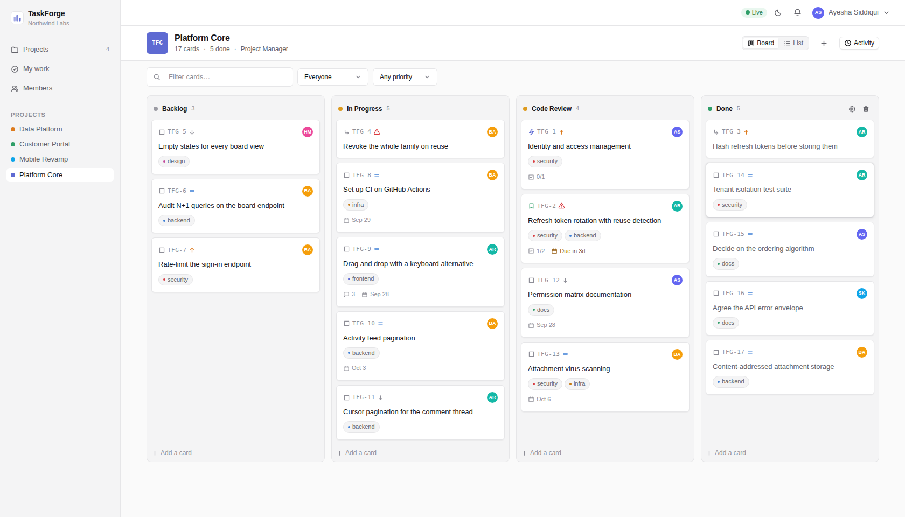

---

## Status

| | |
| --- | --- |
| **API** | 206 automated assertions · strict TypeScript · 20 tables |
| **Client** | 26 browser assertions across three simultaneous users, plus 21 that prove a failed request is never rendered as an empty one |
| **Total** | **253 passing tests, 0 failing** |

```
apps/api          Express 5 + Socket.IO + Drizzle/SQLite   (206 tests)
apps/web          React 19 + Vite + TanStack Query + dnd-kit
packages/shared   zod schemas · DTOs · permission catalogue · socket event contracts
docs              SRS · project plan · architecture · data model · UI audit · 7 ADRs
```

---

## Quick start

Requires **Node 20+**. No database server, no Docker, no accounts.

```bash
npm run setup     # install, migrate, seed a demo workspace
npm run dev       # API on :4000, web app on :5173
```

Open **http://localhost:5173** and sign in as any of:

| Email | Role | What you see |
| --- | --- | --- |
| `ayesha@northwind.test` | Owner | everything, including workspace administration |
| `sara@northwind.test` | Admin · project manager | board configuration, member management |
| `ali@northwind.test` | Member · developer | can create and move cards, cannot configure the board |
| `hina@northwind.test` | Member · **viewer** | read-only board — no composer, no drag |

Password for all: `Password123!`

> **See the realtime layer in ten seconds:** open the board in a normal window and again in a
> private window signed in as someone else. Drag a card. It moves in both, and the presence
> avatars in the header show who else is looking.

| Command | Purpose |
| --- | --- |
| `npm run setup` | Install, create `.env`, migrate, seed |
| `npm run dev` | Run everything with prefixed logs |
| `npm test` | The API suite (206 assertions) |
| `npm run test:e2e` | The browser suite (26 assertions) — needs Playwright |
| `npm run test:error-states` | 21 assertions that break each API call on purpose and check the screen says so — needs Playwright |
| `npm run shots` | Re-capture the screenshots in `docs/screenshots/` |
| `npm run widths` | Report content width as a share of viewport at 1366 / 1600 / 1920 / 2560 |
| `npm run reset` | Wipe the database and re-seed |
| `npm run setup -- --keep-data` | Set up without touching an existing database |
| `npm run typecheck` | Strict `tsc` across all three workspaces |
| `npm run build` | Production build of shared, API and client |

---

## What it does

| Brief requirement | Where it lives |
| --- | --- |
| Create group projects | Workspaces → projects, each provisioning its board in one transaction |
| Assign tasks | Assignee, reporter, priority, due date, story points, labels, watchers |
| Comment and communicate | One-level threads with `@mentions` resolved to real members |
| Auth system | bcrypt, 15-minute access tokens, rotating refresh tokens with reuse detection |
| Project boards and task cards | Kanban **and** list views, configurable columns, `TFG-42` references |
| Backend manages users, projects, tasks, comments | 20 normalised tables, foreign keys enforced |
| **Bonus:** notifications and real-time updates | Socket.IO rooms, presence, live notification badge |

**Beyond the brief:** multi-tenancy with proven isolation · two-tier RBAC (organisation ×
project) · subtasks five levels deep with cycle prevention · optimistic concurrency ·
content-addressed attachments · an append-only audit trail · keyboard-accessible drag and drop.

---

## Screens

| | |
| --- | --- |
| 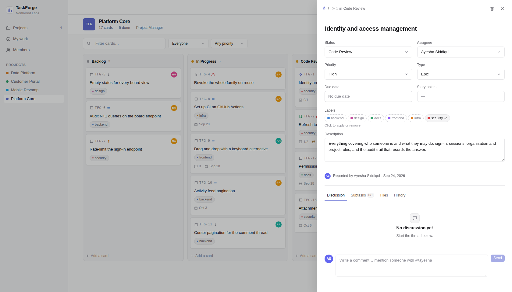 | 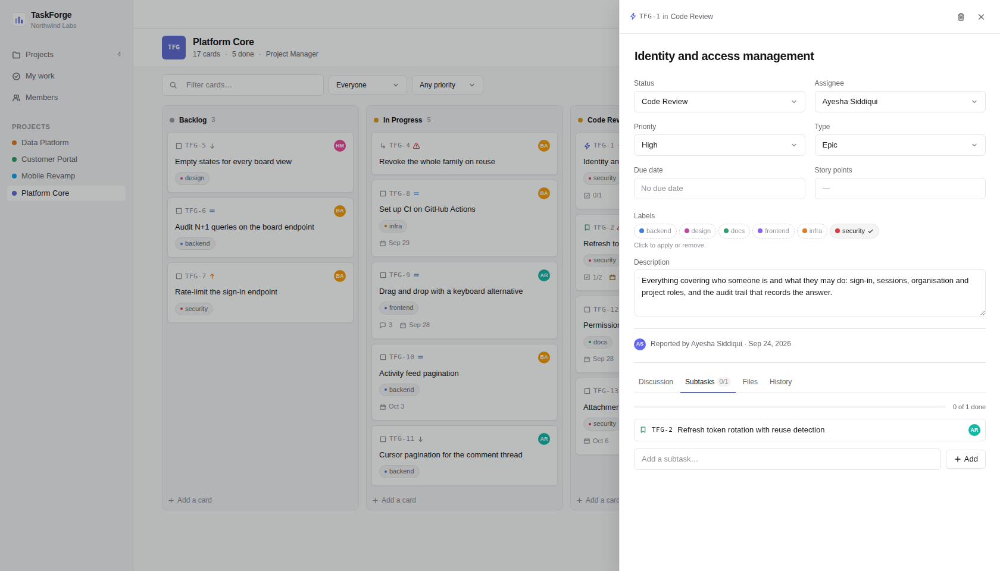 |
| **Task drawer** — status, assignee, priority, type, due date, points, labels and description, each saving on its own with an optimistic-concurrency version | **Subtasks** — a tree five levels deep, with progress rolled up to the parent |
| 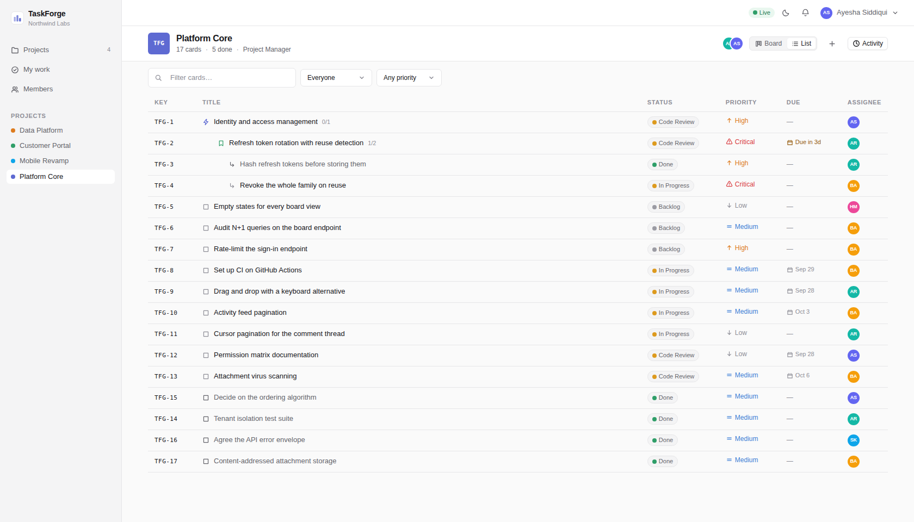 | 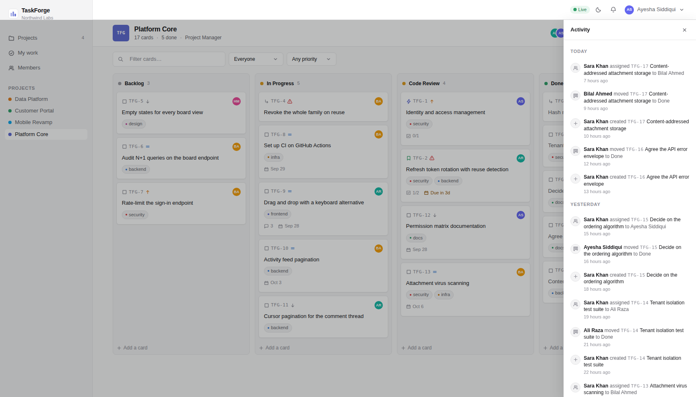 |
| **List view** — the same data arranged for scanning, with the hierarchy preserved; becomes a card list below 900px | **Activity** — an append-only audit trail; every entry names what it happened to |
| 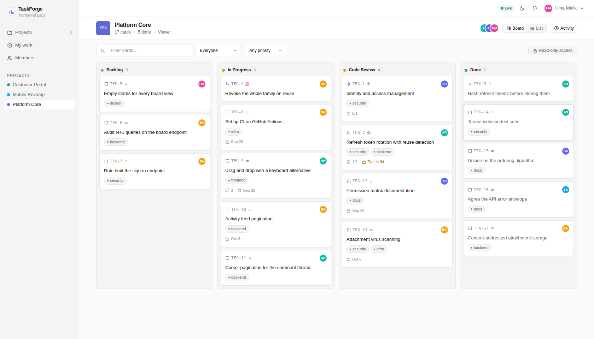 | 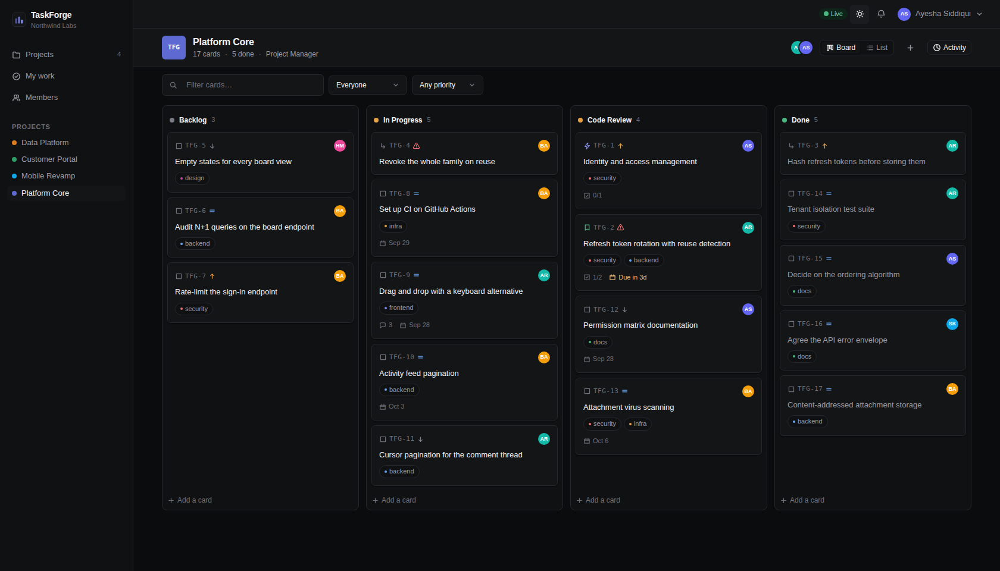 |
| **A viewer** — no composer, no drag, and the server refuses the request even if the UI is bypassed | **Dark theme** — one token set, redefined; no component knows which theme it is in |
| 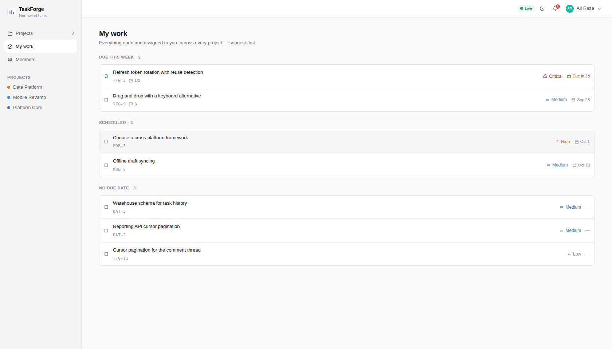 | 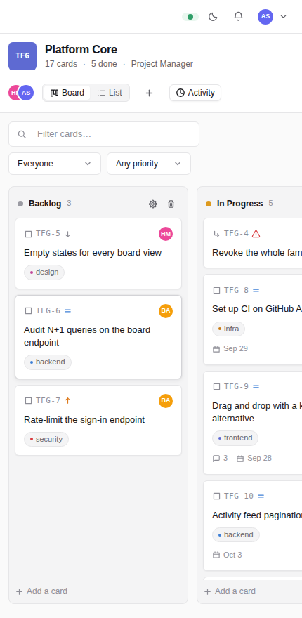 |
| **My work** — everything assigned to you across every project, bucketed by how soon it is due | **Narrow viewports** — the sidebar folds away and columns snap-scroll |
| 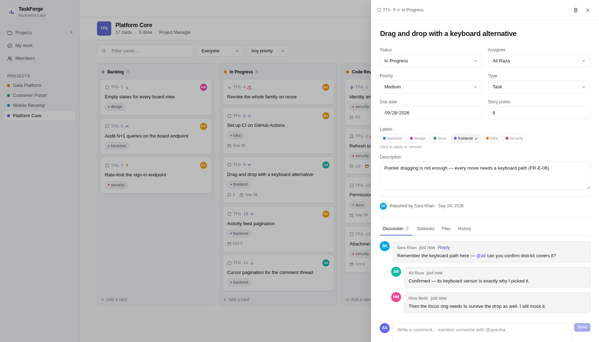 | 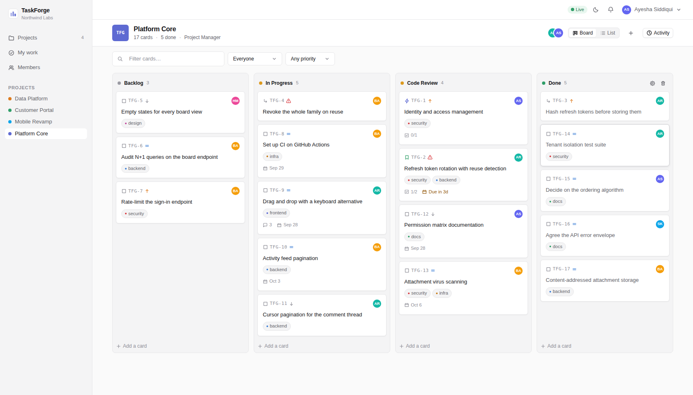 |
| **Discussion** — threaded replies with @mentions that resolve to real members and notify them | **Presence** — avatars of everyone currently on the board, and a live marker on the card someone else is dragging |
| 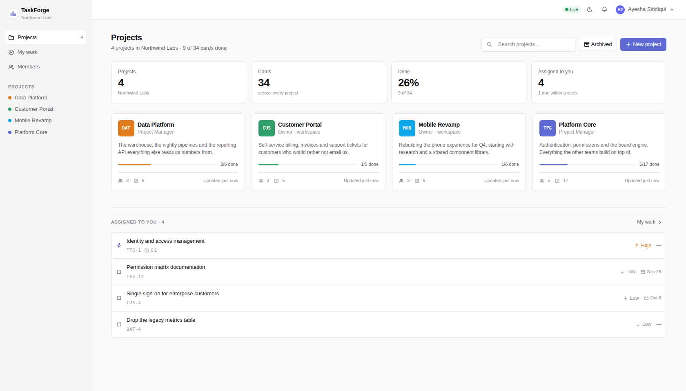 | 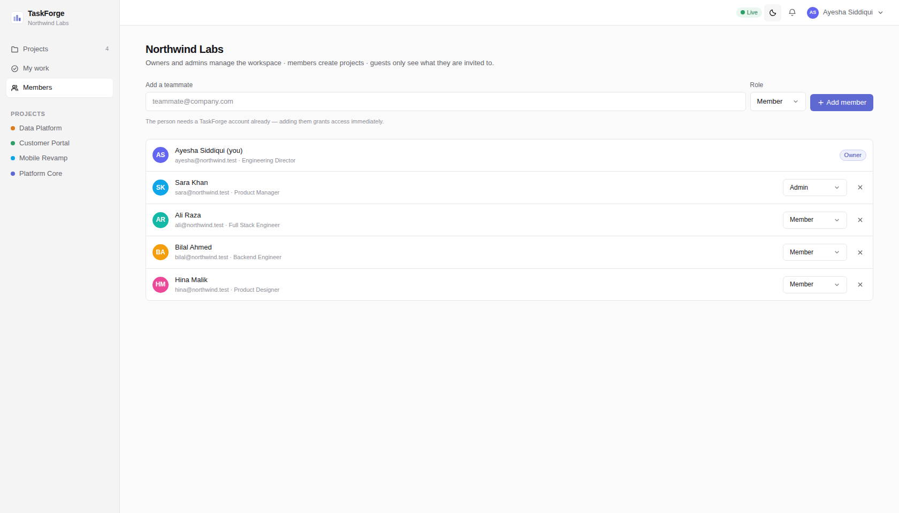 |
| **Projects** — every project you can reach, with progress and your role on each | **Members** — the workspace roster and the two-tier role each person holds |

---

## Architecture

```
┌─────────────────────────────┐        ┌──────────────────────────────┐
│  apps/web  (React 19)       │        │  apps/api  (Express 5)       │
│                             │  REST  │                              │
│  TanStack Query ── cache ───┼───────▶│  routes → guards → services  │
│  Zustand ─────── presence   │        │       │                      │
│  dnd-kit ─────── board      │◀───────┼── Socket.IO  (after commit)  │
└──────────────┬──────────────┘   WS   └──────────────┬───────────────┘
               │                                      │
               └──────── packages/shared ─────────────┘
                   one zod schema per contract:
                   validation, types and socket payloads
```

One rule holds the layers apart, and `dependency-cruiser` enforces it: routes may import
services, services may import repositories, and nothing imports upwards. Services never
import Socket.IO — they publish through a `RealtimeTransport` interface, which is why the
API suite can assert on realtime events without a browser.

Full detail in [`docs/03-ARCHITECTURE.md`](docs/03-ARCHITECTURE.md), with seven decision
records in [`docs/adr/`](docs/adr/).

---

## Design system

The interface is built on four scales — colour, space, type, radius — defined once in
[`apps/web/src/shared/styles/tokens.css`](apps/web/src/shared/styles/tokens.css). No component
stylesheet contains a raw pixel value for spacing or font size.

- **Space** is a 4px grid (`--sp-1` … `--sp-12`).
- **Type** is eight steps, 10px to 26px. Nothing in between.
- **Dark mode** redefines the same tokens, so a component never knows which theme it is in.
  Surfaces are separated by at least one clear step, which is what keeps the board's
  structure legible when the background goes dark.
- **Every element is reset** — `button`, `select`, `input`, `textarea` — so no operating-system
  chrome leaks through. The date field and the selects are ours, not Chrome's.
- **Layout is fluid, and measured.** Side gutters scale with the viewport, board columns stretch
  to fill, and the project grid uses `auto-fit` so cards spread rather than huddling left.
  `npm run widths` reports how much of the screen the content actually occupies — 97–98% from
  1366 to 1920, with a deliberate measure cap above that.
- **Icons are inline SVG** on a 16×16 grid in `currentColor`. No emoji, which render from the
  system font and therefore differ on every machine.

The first version of this interface had none of that, and
[`docs/05-UI-AUDIT.md`](docs/05-UI-AUDIT.md) is the audit that found it: 60 defects, 9 of them
critical, traced back to five root causes. It is kept in the repository because the audit is
more useful than the fix — it records how the problems were found, in what order they were
worth fixing, and which of them a passing test suite could never have caught.

---

## Engineering notes

**Cross-tenant reads return 404, not 403.** A 403 confirms that the record exists. The tenant
isolation suite asserts the status code, not just the refusal.

**Every route is guarded, and the build proves it.** A test walks the live Express router and
fails if any route is missing a permission guard. Two notification routes are allowlisted with
an inline justification rather than given a meaningless permission.

**Board ordering uses sparse fractional ranks.** Moving one card writes one row instead of
renumbering the column, with compaction when the gaps run out.

**Subtasks use a materialised path.** `/root/child/` makes "the whole subtree" one indexed
prefix scan, cycle detection an O(1) string test, and the depth cap a `CHECK` constraint.

**Ids sort by creation time.** The timestamp is encoded in the id itself, so cursor pagination
and "newest first" need no second column — and seeded history uses `newIdAt` so that back-dated
rows keep the invariant rather than quietly breaking the ordering.

---

## Testing

```bash
npm test                 # 206 API assertions

npm install --save-dev playwright && npx playwright install chromium
npm run test:e2e         # 26 browser assertions — starts the servers itself
npm run test:error-states  # 21 assertions on failed-request handling
```

Playwright is deliberately not a dependency, so `npm run setup` stays fast for anyone who
just wants to run the app.

The API suite covers auth and token rotation, tenant isolation, the RBAC matrix, board and
card mechanics, the subtask hierarchy, attachments, collaboration and the audit trail, plus
**17 realtime assertions driving two live socket clients against a real HTTP server**.

The browser suite signs in three users in three contexts and proves the things a screenshot
cannot: a card created by one user appearing for another with no refresh, a real
pointer-driven drag mirrored live, a live notification badge on assignment, and a viewer who
is genuinely unable to edit.

`npm run test:error-states` is the inverse. It intercepts one API call at a time and makes it
fail, then asserts the screen shows an error with a retry **and** that the reassuring sentence
is absent — no "No projects yet" when the request never landed, no "All caught up" over an
unread inbox. Each of the six affected screens is covered, plus a control case proving a
healthy load still renders normally.

`npm run shots` is separate from the E2E suite on purpose. The E2E run creates cards to prove
the realtime path works, and those cards are named after a timestamp — running both from one
pass is how `Live card 1790082655320` once ended up in a committed screenshot.

---

## If something looks out of date

Two failure modes have actually happened here, so both now announce themselves
rather than failing quietly. If you hit either, this is what it is.

**The app shows old data or old code after pulling changes.**
`npm run setup` reseeds automatically when the demo data has changed — it fingerprints
`seed.ts` and compares it against the database it finds, so you do not have to know whether
anything moved. If you want to be certain:

```bash
npm run reset      # wipe the local database and seed it again
```

**The browser shows the old app however many times you restart.**
Almost always a dev server still running from an earlier session: it keeps answering
`localhost:5173` while the one you just started moves elsewhere. `npm run dev` now refuses to
start in that situation and names the port. To clear it by hand:

```bash
# Windows
netstat -ano | findstr :5173
taskkill /PID <pid> /F

# macOS / Linux
lsof -ti:5173 | xargs kill
```

`npm run setup` also clears Vite's transform cache, which is the other way stale CSS survives
a restart. A hard reload in the browser (Ctrl-Shift-R) covers the rest.

---

## Deployment

SQLite is the development default; the schema is written for PostgreSQL and the Drizzle
dialect is the only thing that changes ([`docs/adr/ADR-004`](docs/adr/)). `npm run build`
emits a static client bundle and a compiled API. The API serves the client in production, so
one process is enough.

---

## Licence

MIT — see [`LICENSE`](LICENSE).
